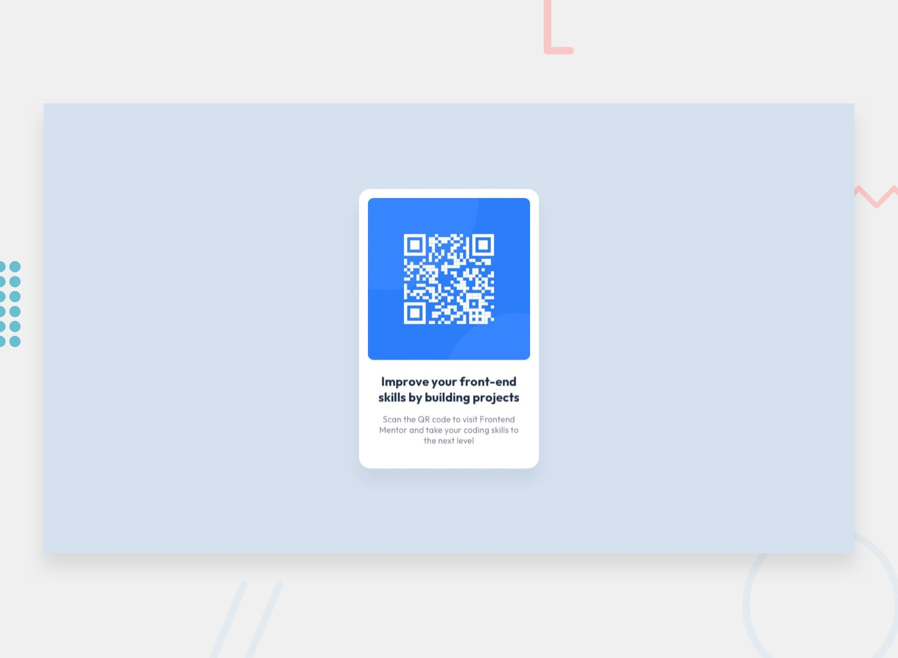

# Frontend Mentor - QR code component solution

This is my solution to the
[QR code component challenge on Frontend Mentor](https://www.frontendmentor.io/challenges/qr-code-component-iux_sIO_H).
I used this beginner-level challenge to practice HTML structure, CSS layout, and
responsive design.

## Table of contents

- [Overview](#overview)
  - [Screenshot](#screenshot)
  - [Links](#links)

- [My process](#my-process)
  - [Built with](#built-with)
  - [What I learned](#what-i-learned)
  - [Continued development](#continued-development)
  - [AI collaboration](#ai-collaboration)

- [Author](#author)

## Overview

### Screenshot

### Links

- Solution URL:
  [https://www.frontendmentor.io/solutions/qr-code-component-with-html-and-css-6XJZJZJZJ](https://www.frontendmentor.io/solutions/qr-code-component-with-html-and-css-6XJZJZJZJ)
- Live Site URL: https://qr-code-card.surge.sh/

## My process

### Built with

- HTML5 markup
- CSS
- Flexbox
- Responsive sizing

### What I learned

I learned how to center a card horizontally and vertically with Flexbox. Setting
`min-height: 100vh` on the `body` gives it at least the full height of the
browser window, allowing Flexbox to center the card vertically.

I also learned that responsive design does not always require a separate mobile
layout or media queries. This card keeps the same design on desktop and mobile,
while its maximum width prevents it from becoming too wide.

### Continued development

I want to keep practising responsive layouts and become more comfortable
choosing flexible CSS units for different screen sizes.

### AI collaboration

I used Devin as a learning assistant. It explained CSS concepts, asked guiding
questions, and helped me think through layout decisions while I wrote the HTML
and CSS myself.

## Author

- Frontend Mentor: [@warishco](https://www.frontendmentor.io/profile/warishco)
